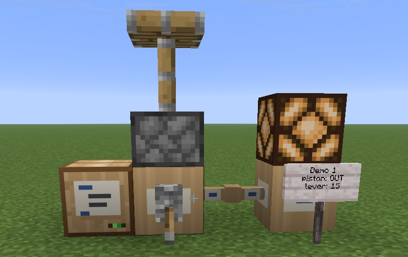

**Billboard API** is a Fabric mod for Minecraft 26.3. It puts Lua programs into the world: a **Lua Box** runs a
program, and **Data Pipes** join it to the machines it drives.

- **Lua Box**: a block that runs one Lua program, written in any text editor and dropped onto its screen. See [Lua Box](Lua-Box).
- **Data Pipes** join Lua Boxes and machines into a network, see [Network and pipes](Network-and-pipes).
- **Redstone Port**: Lua to vanilla redstone. A program powers pistons, doors and lamps, and reads levers,
  pressure plates and buttons. A port can look like any block, see [Redstone Port](Redstone-Port).
- **Signs** are machines too: a program can write on them, see the [Lua reference](Lua-reference).
- **Other mods' machines** join the same network, for example the [Billboard Engine](https://github.com/Knito58/billboard)
  and the Typestones Typewriter. Mod authors: [For mod authors](For-mod-authors).

None of the other mods is needed: a Lua Box, pipes, signs and redstone ports work on their own.

## Start here

1. [Getting started](Getting-started): install, recipes, a first program.
2. [Lua Box](Lua-Box) and [Network and pipes](Network-and-pipes).
3. [Redstone Port](Redstone-Port), then the [Lua reference](Lua-reference).

## Download

- [CurseForge](https://www.curseforge.com/projects/1769807)
- [GitHub releases](https://github.com/Knito58/Billboard-API/releases)

Needs [Fabric API](https://modrinth.com/mod/fabric-api), Fabric Loader 0.19.5 or newer and Java 25.
On a server, install it on the server and on every client.
